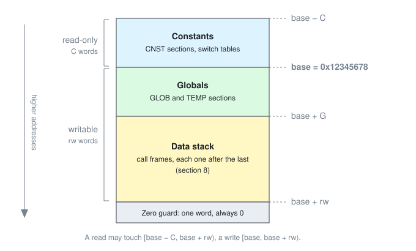
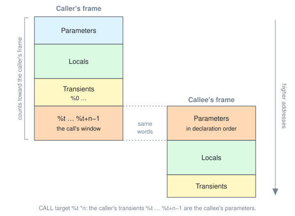

# GAZL 1 Specification

**DRAFT.** This document is meant to let someone who has never seen `src/GAZL.cpp` build a GAZL 1 implementation
that runs every existing program with identical results. It defines the machine model, the source format, execution,
the host interface and the memory snapshot format. The per-instruction reference is
[InstructionSet.md](InstructionSet.md); the conformance suite is [`src/UnitTest.gazl`](../../src/UnitTest.gazl).
Where this draft and the reference implementation disagree, the disagreement is a bug in one of them and is listed
under [Open questions](#13-open-questions).

"Must" marks a requirement on every implementation. "Unspecified" means an implementation may produce any result,
but must stay inside the sandbox (section 10). Nothing in GAZL 1 is undefined in the C sense.

## 1. Compatibility promise

GAZL programs are distributed as source text and assembled when they are loaded, often years after they were
written. So the format only ever grows:

- A program that assembles under one GAZL 1 implementation must assemble under every later one, and run with
  identical results and statuses.
- New instructions, new operand forms and new assembly-time constants may be added, but only where the same text
  used to be an assembly error.
- The meaning of an accepted form never changes, and no accepted form is removed.
- One exception: a form whose execution could break the sandbox may start being refused at assembly. That has
  happened once (frames past `INT_MAX`, `FRAME_TOO_LARGE`), and must be recorded in this section when it happens.
- Every implementation predefines `#GAZL_VERSION`, the version of the engine, and `#GAZL_WORD_SIZE` (32). A GAZL 1
  engine reports 1.
- Later versions are supersets, not replacements. A GAZL 2 engine reports 2 and assembles every GAZL 1 program
  unchanged; its additions are mnemonics that GAZL 1 refuses, used inside `GAZL #2` ... `GAZL #1` regions. A program
  that needs a later version tests for it at assembly, with `! GEQi #GAZL_VERSION #2 @label`, rather than for an
  exact value.

## 2. Values

Every value is one 32-bit **word**. A word has no tag; the instruction that uses it decides its type.

| type    | meaning                                                                                                   |
| ------- | --------------------------------------------------------------------------------------------------------- |
| int     | two's-complement signed 32-bit integer                                                                    |
| float   | IEEE-754 binary32                                                                                         |
| pointer | `0x12345678 + n`, `n` words from the base of data memory (section 3), negative for constants; `0` is null |
| funcptr | `0x56789ABC + k`, the function with ordinal `k`, in declaration order across all units                    |

A word moved with `MOVE`, `PEEK`, `POKE`, `COPY`, `GETL` or `SETL` keeps its 32 bits exactly, whatever its type,
including the bits of a float NaN.

Byte order is never visible to a program. Memory is an array of words, not bytes, and no instruction reads part
of a word. That is what lets GAZL run unchanged on big- and little-endian hosts.

## 3. Data memory

Data memory is one array of words, sized by the host. Every address is measured from the **base**, the pointer
`0x12345678`: globals and the data stack lie at and above it, constants below it.

- **Globals** are placed from the base upward, and **constants** from the base downward. The assembler also places
  switch tables among the constants.
- **Within a section, the layout is strict.** A section's words are contiguous, in the order its data statements
  fill them, whether the section is named or not. It has exactly the size it declares (section 6).
- **Between sections, nothing is promised.** An implementation may place sections in any order and leave unused
  words between them, for example to align each section to 64 bits for a JIT. A pointer computed from one section
  into another stays inside memory, but which word it reaches is unspecified. (The reference implementation places
  sections in declaration order, with no gaps.)
- `C` and `G` are the space the constants and the globals take, gaps included.
- **The data stack** is everything above the globals, up to the zero guard.
- **The zero guard** is the last word of memory, just above the data stack. It always holds 0, so a native scanning
  for a string's terminator stops there. No checked read reaches it.

Addresses therefore depend on the program and the implementation, never on the memory size: neither globals nor
constants move when the host chooses a different memory size. Only the size of the data stack does. The host must
provide at least `C + G + 1` words, the constants, the globals and the zero guard; every word beyond that is data
stack.

A read must succeed exactly when its pointer is in `[base - C, base + rw)`, and a write exactly when it is in
`[base, base + rw)`. An address is `base + offset` computed with 32-bit wrap-around, so an offset can never carry
an access around the end of memory and back in.

**`COPY`** checks the whole source range for reading and the whole destination range for writing before it moves
anything. It then copies forward, one word at a time from the lowest address up, so overlapping ranges have a
defined result: a destination below the source copies like `memmove`, and a destination above the source, inside
it, repeats the leading words.

## 4. Arithmetic

**Integers.** `ADDi`, `SUBi` and `MULi` wrap modulo 2^32. Shift counts are taken modulo 32. `SHRi` is arithmetic and
`SHRu` logical. `DIVi` truncates toward zero and `MODi` takes the sign of the dividend; `INT_MIN / -1` is `INT_MIN`
and `INT_MIN % -1` is 0. Division or modulo by zero stops the program with `DIVISION_BY_ZERO`, and is refused at
assembly when the divisor is a constant 0.

**Floats.** Arithmetic is IEEE-754 binary32 with round-to-nearest-even, infinities and NaNs included.
- **One rounding per instruction.** Each instruction's result is rounded to binary32 exactly once. Computing in a
  wider format (x87 extended precision) or fusing instructions (a multiply and an add contracted into one FMA) is
  not allowed, in the interpreter, at assembly or in a JIT.
- **No finite-math assumption.** An implementation must not assume that values are finite or that a NaN equals
  itself: `NEQf x x` must branch for a NaN, and infinities must compare and convert as specified. An implementation
  compiled with options that break this (`-ffast-math`, `-Ofast`, `/fp:fast`) does not conform.
- **Division by zero** follows IEEE-754 too: `DIVf` by a zero of either sign gives an infinity of the matching sign,
  and `0 / 0` gives NaN, at run time and at assembly alike. Only integer division stops the program.
- **NaN bits.** A NaN computed by an instruction is a quiet NaN, but its sign and payload are unspecified, because
  hardware differs: x86 produces `0xFFC00000` where ARM produces `0x7FC00000`, and the two pick differently between
  two NaN operands. A NaN that is only moved keeps its bits exactly (section 2).
- **Signed zero.** `-0.0` equals `0.0` in `EQUf` and `NEQf`. `ABSf` of `-0.0` is `0.0`, and `fTOi` of either is 0.
- **Denormals** follow the host thread's floating-point environment (flush-to-zero, denormals-are-zero), which GAZL
  neither sets nor restores, so a result that involves denormals may differ between implementations and hosts. That
  is accepted.

**Conversions.** `fTOi` multiplies by its scale operand, then truncates toward zero; values at or beyond 2^31 in
magnitude, and infinities, saturate to `INT_MAX` / `INT_MIN`, and NaN converts to 0. `iTOf` converts to the nearest
float, then multiplies by its scale operand.

**Float comparisons.** `EQUf` and `NEQf` follow IEEE-754: a NaN is unequal to everything, itself included. So
`NEQf x x @L` branches exactly when `x` is NaN, and that is the supported way to test for one. When either operand
of `LSSf`, `LEQf`, `GRTf` or `GEQf` is NaN, whether it branches is unspecified. Today's interpreter branches for
`LEQf` and `GEQf` and not for `LSSf` and `GRTf`, but programs must not rely on that.

**Pointers.** `ADDp` and `SUBp` add or subtract an int, wrapping modulo 2^32. `DIFp` is the difference in words.
Pointer comparisons compare the two words as **signed** ints. A function pointer supports only `EQUp`, `NEQp` and
calling; any other operation on it gives an unspecified, memory-safe result.

## 5. Source text

A program is ASCII text, one statement per line. Lines end with LF, CR or CRLF. A comment may hold any bytes,
since it is ignored; GAZL defines no encoding for them. A byte above 0x7F anywhere else, `DATs` text included, is an
assembly error.

    [label:]  [!]  MNEM  [operand  [operand  [operand]]]  [; comment]

- **Mnemonics** are exactly four characters and case-sensitive.
- **Separators.** Tokens are separated by spaces or tabs. A `;` starts a comment that runs to the end of the line.
- **Quotes.** A token may contain a quoted part (`'...'` or `"..."`); spaces inside the quotes don't end it.
- **Identifiers** name everything a program declares: data sections, functions, natives, named constants, locals
  and labels. The rule is exact, and an assembler must refuse anything else with `INVALID_IDENTIFIER`:
  - **First character:** one of the 55 ASCII characters `A`-`Z`, `a`-`z`, `_`, `.` or `$`.
  - **Every following character:** one of those, or an ASCII digit `0`-`9`, so 65 characters in all.
  - **No other characters:** no other punctuation, no spaces, no bytes above 0x7F.
  - **Length:** at least 1 character, with no upper limit.
  - **Case:** case-sensitive, so `Gain` and `gain` are different names.

  As a regular expression: `[A-Za-z_.$][A-Za-z0-9_.$]*`. A switch case label (`@sw#'B'`, see `SWCH` in
  InstructionSet.md) is an identifier followed by `#` and a constant; the `#` part is not part of the identifier.

**Operands** are classified by their first character:

| prefix | operand                                                         | example                |
| ------ | --------------------------------------------------------------- | ---------------------- |
| (none) | local variable, optionally `name:offset` into a local array     | `x`, `buf:3`           |
| `%`    | transient `n`: the `n`-th word after the function's locals      | `%0`                   |
| `#`    | constant: a literal or a named assembly-time constant           | `#12`, `#0.5`, `#TRUE` |
| `<`    | assembly-time variable: one of `A-Za-z0-9_.$` in `<` `>`        | `<A>`, `<x>`, `<0>`    |
| `&`    | address of a data section or function, optionally `:offset`     | `&table:4`, `&main`    |
| `^`    | native function                                                 | `^print`               |
| `@`    | branch label in the current function                            | `@loop`, `@sw.3`       |
| `*`    | non-negative size constant                                      | `*16`                  |

**Offsets.** `&label:k` and `local:k` take a constant `k >= 0`.
- **Accesses are checked at assembly.** Where an instruction reads or writes the word at `&label:k` (`PEEK`,
  `POKE`, `COPY`), that word must lie within the label's section; it may be owned by a later label (section 6). A
  local array offset must lie within the array.
- **Addresses are not.** Where `&label:k` is only a value (`MOVp`, `ADDp`, `DIFp`, pointer compares, `FORp`,
  `DATp`, `DATA`), any offset is accepted, one past the end of the section included. An access through such a
  pointer is checked at run time (section 3).
- **A function address takes no offset.** `&function:k` with `k > 0` is `OFFSET_OUT_OF_BOUNDS`: it would name
  another function.

**Integer literals** are decimal, or hexadecimal after a lowercase `0x`, with an optional sign. A quoted literal
(`'AB'`) packs its characters into one int, the first character in the most significant byte used. A value outside
32 bits wraps. A literal that parses completely as an integer is an int, so a float operand needs a float literal:
`#1.0`, not `#1`.

**Float literals** have the form `[sign] digits [. digits] [e exponent]`. Their value is the literal's exact decimal
value rounded to the nearest float, ties to even: correctly rounded conversion, independent of any C library. The
same rule sends a value too large for a float to infinity and a value too small to zero, keeping the literal's
sign. There is no literal for infinity or NaN.

## 6. Program structure

A program is one or more **units** (source files) assembled in order into one program.
- **Shared across units:** global names, meaning data sections, functions and named constants.
- **Reset per unit:** assembly-time variables.

**Data sections.** `GLOB *n`, `TEMP *n` and `CNST *n` each reserve a section of exactly `n` words. The statement's
label, if it has one, names the section and its first word; a section without a label is unnamed. The data
statements that follow fill it in order:
- `DATi`, `DATf` and `DATp` write one or more ints, floats or pointers; `DATA` writes one or more values of mixed
  types.
- `DATs text` writes the rest of the line, one ASCII character per word, with trailing blanks removed. A byte
  above 0x7F in the text is `NON_ASCII_TEXT`. Impala emits every other character as numbers on a `DATi` line.
- A label on a data statement names the statement's first word. A data statement without values is legal and
  writes nothing.
- Words left unfilled are 0.
- A data statement that would write past the section's `n` words is `DATA_SECTION_FULL`. Data never spills into
  whatever follows.

`TEMP` is `GLOB` that a memory snapshot skips (section 11). `CNST` sections are read-only.

**Memory ownership.** Every word of a data section has exactly one owner, and an owner is a label: the section's
own label, or a label on one of its data statements.
- **The last label owns.** A word belongs to the last label at or before it in its section. An owner's words run
  from its own word up to the next label, or to the end of the section, unfilled words included.
- **Labels on the same word.** The later one in the source owns the words; the earlier one owns none.
- **No owner is an error.** In an unnamed section, data before the first labelled statement would belong to no one,
  and so would every word of an unnamed section with no labelled statement: `UNNAMED_DATA_SECTION`.

So every word is named by exactly one `owner:offset`, and that is what a snapshot saves (section 11). For example:

    buffer: GLOB *40
            DATi #5954          ; buffer:0, the only word buffer owns
    tail:   DATi #1             ; tail:0, and tail owns tail:1 to tail:38 too
            GLOB *1
    clock:  DATi #0             ; clock:0, an Impala scalar

Without the `DATi #5954` row, `tail` would own all 40 words and `buffer` none. Owning is not addressing:
`&buffer:5` still reaches the word `tail:4` (section 5).

**Functions** start with `FUNC`, labelled with the function's name.
- **Declarations first.** Parameters (`PARA`, `INPi/f/p`, `OUTi/f/p`) and locals (`LOCi/f/p`, `LOCA *n`) come
  before the first instruction.
- **Ending.** The last instruction must be `RETU` or `GOTO`.
- **Labels** are local to their function. A branch may not target the position where the next `FUNC` starts
  (`LABEL_ON_FUNCTION`).
- **`NOOP`** generates nothing; it exists so a line can carry a label.

**Frame size.** A function's frame is its parameters and locals, plus its transients: one word past the highest
`%n` the function uses. A frame that would reach `2^31` words is refused at assembly.

## 7. Assembly-time evaluation

A statement prefixed with `!` runs while the program is assembled and generates no code:
- `! DEFi`, `! DEFf` and `! DEFp` define a named constant: the statement's label.
- `! MOVi <A> #1`, `! ADDi <A> <A> #2` and so on compute into assembly-time variables. A variable's name is exactly
  one identifier character (section 5) between `<` and `>`, so there are 65 of them. Names are case-sensitive: `<a>`
  and `<A>` are different variables. All are cleared at the start of each unit, and reading one that the unit has not
  set, or as a different type than it holds, is an assembly error.
- `! IFDF`, `! IFND`, the compare-and-branch forms and `! GOTO` skip forward to a label. Skipping is forward only;
  a skip that never reaches its label fails the unit.
- `! FAIL text` stops assembly with the text.

An ordinary instruction whose operands are all constants is evaluated at assembly instead. Its result must be
**exactly** what the same instruction would produce at run time. That includes wrap-around and `fTOi`
saturation. A run-time error, such as a constant division by zero, becomes an assembly error.

## 8. Calls

`CALL target %t *n` calls a function or native. Its arguments are the caller's transients `%t` to `%t + n - 1`, and
they become the callee's parameters in declaration order. Output parameters are written back there, so after the
call the caller reads its results from the same transients. The transients up to `%t + n - 1` count toward the
caller's frame, so the window is always inside the data stack.

- **`&function`** calls directly.
- **A pointer variable** calls through a function pointer. A value that is not a valid function pointer stops the
  program with `BAD_CALL`.
- **`^native`** calls a host function (section 9).

Call depth is limited by the host's call-stack size (`IP_STACK_OVERFLOW`). Frame space is limited by the data
stack: `FUNC` checks that the whole frame fits (`DATA_STACK_OVERFLOW`). `GETL` and `SETL` index a local array at
run time and are checked against the end of the data stack (`BAD_PEEK`, `BAD_POKE`).

## 9. Execution and the host

**Starting.** The host assembles the units, creates a processor over the code and memory, and calls a function with
`enterCall`. Then it calls `run` until `run` returns something other than `TIME_OUT`. `enterCall` may be called
again at any time, even while a program is suspended; it pushes a new call on top, which is how a host delivers
an interrupt.

**The step budget.** The host gives `run` a budget of steps (`resetTimeOut`).
- **Cost.** Every executed instruction costs one step, including `FUNC` on entry. `NOOP` and assembly-time
  statements cost nothing.
- **Exhaustion.** When the budget runs out, `run` returns `TIME_OUT` between two instructions, and the next `run`
  continues exactly there. Pausing never changes what a program computes: resumed to completion, it gives the same
  results as an uninterrupted run.
- **Granularity.** An implementation may check the budget at coarser points than every instruction, for example
  once per block of straight-line code, as long as it stops within the budget plus the cost of one such block.
  Which instruction it stops at, and the budget left at that point (`getClockCyclesLeft`), are therefore
  implementation-defined. The reference interpreter checks before every instruction.

**The floating-point environment** belongs to the host thread, and GAZL neither sets nor restores it (section 10).
So the host must run GAZL, assembly included, with:
- **floating-point exceptions masked,** the default. An unmasked trap turns an ordinary `inf - inf` into a hardware
  exception that no implementation can contain, so the sandbox (section 10) does not hold without this;
- **round-to-nearest-even,** the default. Another rounding mode changes results and assembly-time constants.

Flush-to-zero and denormals-are-zero may be set either way (section 4).

**Natives** are host functions registered by name, so a program refers to them by name and the host maps them to
code. A native sees the call's argument window through `accessParams`, and data memory through
`accessConstMemory` / `accessMemory`, which grant exactly the ranges in section 3. A native's own arithmetic
(`sqrt`, `log` and so on) is the host's, and its precision is outside this specification. What it returns decides
what happens next:
- **0** continues after the `CALL`.
- **Non-zero** makes `run` return that status with the `CALL` not yet completed, so the next `run` calls the
  native again. That is how a native blocks until something is ready.
- **`resetTimeOut(0)`** from inside a native makes `run` return `TIME_OUT` before the next instruction.
- **`pushCall`** from inside a native runs a GAZL function in place of returning from the native.

**Statuses** returned by `run`. Positive values are free for hosts' own natives:

| status                | value | meaning                                                         |
| --------------------- | ----- | --------------------------------------------------------------- |
| `OK`                  | 0     | the call started by `enterCall` returned                        |
| `TIME_OUT`            | -1    | the step budget ran out; resumable                              |
| `BAD_PEEK`            | -2    | read outside readable memory, or `GETL` outside the data stack  |
| `BAD_POKE`            | -3    | write outside writable memory, or `SETL` outside the data stack |
| `BAD_CALL`            | -4    | call through a value that is not a function pointer             |
| `DATA_STACK_OVERFLOW` | -5    | a frame does not fit in the data stack                          |
| `IP_STACK_OVERFLOW`   | -6    | call depth exceeds the call stack                               |
| `DIVISION_BY_ZERO`    | -7    | `DIVi` or `MODi` by zero                                        |
| `ACCESS_VIOLATION`    | -8    | `COPY` outside memory, or a native refused an access            |
| `ABORTED`             | -9    | a native reports unexpected termination                         |
| `TERMINATED`          | -10   | a native reports expected termination (e.g. `exit`)             |

After an error status the processor still points at the failing instruction, so running it again fails again. A
host recovers by starting a new call.

## 10. The sandbox

Whatever the program text, an implementation must guarantee all of the following:

- **Memory.** No read or write outside the memory the host provided, and no write to read-only memory. Every
  failing access either stops the program with a status from the table above or is refused at assembly.
- **Isolation.** No effect outside the processor except through natives. No process-wide state is touched:
  signal handlers, the floating-point environment, global variables.
- **Interruptibility.** Every program stops within its step budget, plus at most one block (section 9).
- **Determinism.** The same program, inputs and natives give the same results and statuses on every conforming
  implementation, except where this specification leaves a result unspecified, and except for denormals
  (section 4).

These hold as long as the host keeps the floating-point environment required in section 9.

## 11. Memory snapshot format

A snapshot ("freeze") saves the values of a program's writable memory by owner (section 6), so a later run can
restore them by name ("thaw"), even after the program has been changed and re-assembled. A snapshot is a payload
that a host embeds in its own storage (a plugin state chunk, a preset file); it is not a file format of its own.

This format is decided but not implemented yet: today's `freezeMemory` / `thawMemory` write an earlier layout of the
same idea (open question 2).

**Encoding.** A snapshot is a sequence of bytes built from two kinds of field:
- A **word** is 4 bytes holding an unsigned 32-bit value, little-endian: bits 0-7 first, bits 24-31 last.
- A **name** is an owner's identifier (section 5), one byte per character, followed by 0 to 3 zero bytes of
  padding, so that the name and its padding together take a multiple of 4 bytes. A name of `L` bytes has
  `(4 - L % 4) % 4` padding bytes.

Every field starts at a multiple of 4 bytes from the start of the snapshot. A reader must still decode each word
byte by byte, as above, and never by loading it through a pointer.

**Header,** 20 bytes:

| offset | field                                                   |
| ------ | ------------------------------------------------------- |
| 0      | magic, the bytes `G` `Z` `M` `M` (`47 5A 4D 4D`)        |
| 4      | word: snapshot format version, 1                        |
| 8      | word: the GAZL version of the writer, 1 for GAZL 1      |
| 12     | word: word size in bits, 32                             |
| 16     | word: `S`, the number of entries that follow, `S >= 1`  |

**Entries.** `S` entries follow from offset 20, each directly after the previous one:

| field     | content                                                     |
| --------- | ----------------------------------------------------------- |
| word      | `L`, the length of the name in bytes, excluding its padding |
| name      | `L` bytes, then the padding                                 |
| word      | `N`, the number of words                                    |
| `N` words | the owner's words, first word first                         |

**The check entry** is always the first entry. It is recognised by its position, never restored, and exempt from
the name order below. Its 28 bytes are fixed:

    05 00 00 00   24 67 61 7A 6C 00 00 00   03 00 00 00   04 03 02 01   00 00 80 3F   01 00 80 7F
    L = 5         "$gazl" + 3 padding       N = 3         0x01020304    1.0f          signaling NaN

A writer must produce its words the way it produces any other entry's: the first from an int, the second from
the float `1.0f`, the third from a word holding a signaling NaN. A reader must parse it like any other entry and
then compare all 28 bytes. It proves the reader decodes lengths, names, padding and words exactly as the writer
encoded them, and that floats travel as raw bits, a NaN's payload included. Any mismatch is `MEMORY_BAD_CANARY`.

**Program entries** follow, in strictly ascending ASCII order of their names: one for each owner in a `GLOB`
section that owns at least one word, holding exactly the words it owns. Every word of a `GLOB` section is therefore
saved exactly once. Owners in `CNST` and `TEMP` sections are left out. In the example of section 6, the entries
are `buffer` (1 word), `clock` (1 word) and `tail` (39 words); Impala's arrays (`params: GLOB *4`) and scalars
(`GLOB *1`, then `clock: DATi #0`) each give one entry.

An entry's words are memory exactly, 32 bits each, whatever their type: an int as its two's-complement bits, a
float as its binary32 bits, a pointer as its raw value.

**Validation.** A reader validates the whole snapshot before restoring anything. On the first problem below, looked
for in this order, it restores nothing and returns that problem's status:

| problem                                                                              | status                |
| ------------------------------------------------------------------------------------ | --------------------- |
| fewer than 4 bytes, or the magic is wrong                                            | `MEMORY_BAD_MAGIC`    |
| the header is incomplete                                                             | `MEMORY_TRUNCATED`    |
| the format version is not 1, or the GAZL version is 0 or above the reader's own      | `MEMORY_BAD_VERSION`  |
| the word size is not 32                                                              | `MEMORY_BAD_WORDSIZE` |
| a length runs past the end of the snapshot                                           | `MEMORY_TRUNCATED`    |
| the check entry differs from the one above                                           | `MEMORY_BAD_CANARY`   |
| a name is not a valid identifier, names do not ascend strictly, or padding is not 0  | `MEMORY_MALFORMED`    |
| bytes follow the last entry                                                          | `MEMORY_MALFORMED`    |

**Restore.** Only after validation succeeds, the reader matches the snapshot's entries to the re-assembled
program's owners in `GLOB` sections, by name. Both lists are in ascending name order, so this is one pass over the
two. Each name falls in exactly one case:
- **An entry and an owner of the same size:** the words are restored.
- **An entry and an owner of different sizes:** the host chooses, for the whole restore, between two policies.
  - *Prefix:* the owner's first words are filled from the entry's first words, as many as both have. If the owner
    is larger, its remaining words are left unchanged; if it is smaller, the rest of the entry is dropped.
  - *Skip:* the owner is left unchanged, and the entry is dropped.
- **An entry with no owner:** dropped.
- **An owner with no entry:** left unchanged.

Restore writes nothing else: every word it does not restore keeps whatever it held before.

The status says whether the snapshot fitted the program exactly:
- **`MEMORY_OK`:** every entry met an owner of the same size, and every owner had an entry.
- **`MEMORY_MISMATCH`:** anything else, even once. The data has been restored as far as the policy allows, but the
  snapshot looks as if it belonged to a different program. The host decides what to do: run the program as it is,
  call a function of the program that restores backwards compatibility, or discard the state by re-creating the
  processor.

`MEMORY_MISMATCH` is new. A host that wants to know which names did not fit can compare the snapshot's entries with
the program's owners itself.

**When to freeze and thaw.** Both are defined only while no processor that uses the memory is inside a call: frames
on the data stack are not saved, and a suspended call would see its globals change under it. Several processors may
share one memory, so GAZL cannot check this; it is the host's responsibility. The usual order is to assemble, create
the processor, thaw, and only then call the program, so that unchanged words still hold their initial values.

**Untrusted snapshots.** A snapshot may come from anywhere, a preset downloaded from the web included. Whatever it
holds, validation and restore never write outside the owners they restore, so the sandbox (section 10) holds. The
restored values are untrusted as well: a program should range-check a restored value it uses as an index. Even an
unchecked one only makes a later access fail its run-time check.

**Data only.** A snapshot holds data and nothing else. Its meaning depends on two more parts, both the host's to
keep with it:
- **Code:** the GAZL source the program was assembled from.
- **Constants:** every constant the host supplied at assembly.

A restore is exact, pointers included, for the same program assembled by the same implementation: the same code,
the same constants and the same engine. The re-assembly then rebuilds an identical layout and identical function
ordinals (section 2), and every entry is restored exactly. Another implementation may lay out sections differently
(section 3): entries still restore by name and size, but data pointers are valid only if their targets kept their
addresses.

Restoring into a changed program works by name, as above, but nothing more is promised:
- the snapshot records no types and no layouts;
- an owner whose meaning changed receives the old words as they were, and still returns `MEMORY_OK` if its size
  did not change;
- data pointers and function pointers are raw values, valid only if their targets did not move;
- a pointer into the data stack is never valid after a restore, not even into the same program, since the frames it
  pointed into are gone.

Migrating data between program versions is outside this specification.

**Versions.** A reader accepts a snapshot from any GAZL version up to its own, because a word in memory means the
same in GAZL 1 and GAZL 2. A GAZL version that changes what memory contents mean must say so here.

**Storing snapshots.** The format protects its structure, not its bits. A host should:
- store the snapshot's exact byte length with it, since validation requires the reader to be given exactly the
  bytes that were written;
- store a checksum with it (CRC-32 at least) and verify it before calling `thawMemory`. Strongly recommended:
  validation catches damaged lengths and names, but not a changed bit inside an entry's words.

## 12. Conformance

An implementation conforms when it runs the following with the expected results:
- **`src/UnitTest.gazl`.** It must assemble and its `test` function must run to completion.
- **The replayed fuzz inputs** in `tests/fuzz/` must neither crash the implementation nor break the sandbox.
- **`tools/GAZLBoundsSweep.cpp`'s oracle** must agree with every memory access at every edge of memory.

## 13. Open questions

Each is a decision for the format's owner. Until one is decided, the current behaviour of `src/GAZL.cpp` is the
answer.

1. **Float literals are correctly rounded from #130 on.** Before it, the reference implementation accumulated the
   digits in binary64 and scaled them with `pow`, which rounded some literals differently from section 5, mostly
   exact ties such as `2180774.875`. None of the float literals in existing GAZL or Impala sources changes value.
2. **The snapshot format is decided but not implemented.** Section 11 is the format to build. Today's
   `freezeMemory` / `thawMemory` write and read an earlier layout of the same idea:
   - the two check words sit in the header rather than in a `$gazl` check entry, and there is no NaN word;
   - names are not padded, and entries follow the assembler's own order rather than ascending names;
   - a named section is saved whole, and labels inside it are not saved, where section 6 makes every label an
     owner (the assembler already gives every word an owner, with data labels running to the next label);
   - the reader accepts only its own GAZL version;
   - it restores while it parses, so a truncated snapshot restores the entries before the damage, and there is
     no `MEMORY_MALFORMED`.
   No snapshots exist yet that must stay readable, so the implementation can switch to section 11 directly.
